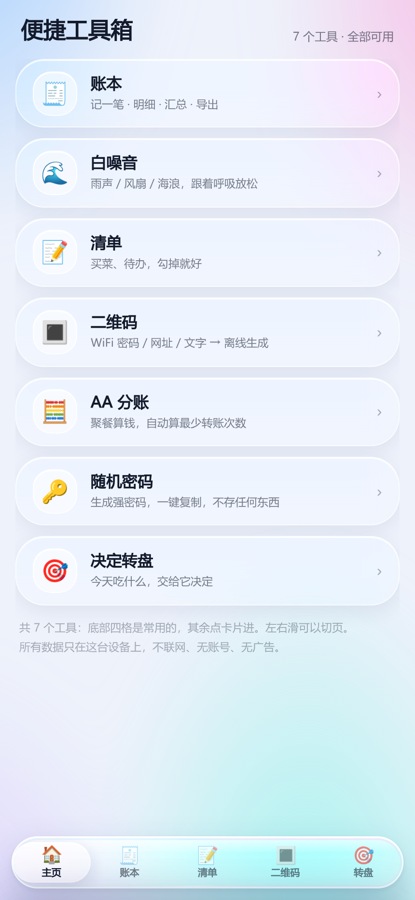

# 便捷工具箱 · Convenience Box

一个离线优先的安卓小工具箱。7 个小工具挤在一个单文件 WebView 页面里，装到手机上就能用 —— 不联网、不上传。



## 关于版本号

仓库的 **1.0** = 安装包里显示的 **1.9**。

公开发布之前，这个应用自己已经内部迭代过 1.0 → 1.9 十个版本（改版式、修返回键、调删除键方向……）。公开时从 1.0 重新起算，所以会出现这个差异。下一次功能更新直接跳 **2.0**，届时两边就对齐了。

## 功能

| 工具 | 做什么 |
| --- | --- |
| 账本 | 记收支，按分类看合计 |
| 白噪音 | 几种环境音，助眠 / 专注 |
| 二维码 | WiFi 密码 / 网址 / 文字 → 离线生成，不外传 |
| AA 分账 | 聚餐算钱，自动算最少转账次数 |
| 清单 | 待办 / 购物单，滑动删除 |
| 随机密码 | 生成强密码，一键复制，不存任何东西 |
| 决定转盘 | 今天吃什么，交给它决定 |

底部五格：主页 / 账本 / 清单 / 二维码 / 转盘；白噪音、AA 分账、随机密码从主页卡片进（浮层 + 返回键退出）。

## 安装

去 [Releases](../../releases) 下 apk 直接装（Android 7.0 / API 24 起），需要允许「安装未知来源应用」。

## 从源码构建

一个 HTML 页面 + 一个 WebView 壳，**不用 Gradle**：

- `app/assets/index.html` —— 整个应用（单文件，CSS / JS 和二维码库都内联，离线可用）
- `app/java/com/cc/conveniencebox/MainActivity.java` —— WebView 壳；硬件返回键由页面同步上报「还有几层可退」，到 0 层才退出
- `buildbox.sh` —— aapt2 → javac → d8 → zipalign → apksigner

需要 JDK 17 + Android SDK build-tools 34。签名自备（仓库里不含 keystore 和口令）：

```bash
ANDROID_HOME=~/Android/sdk KS=~/my.jks KS_PASS=你的口令 KS_ALIAS=myalias ./buildbox.sh
```

## 隐私

应用不申请 INTERNET 权限。账本、清单、密码都只写在本机 WebView 的 localStorage 里，卸载即消失。

## 第三方

- [QR Code Generator for JavaScript](https://github.com/davidshimjs/qrcodejs) © 2009 Kazuhiko Arase —— MIT，已内联进 `index.html`

## License

MIT，见 [LICENSE](LICENSE)。
